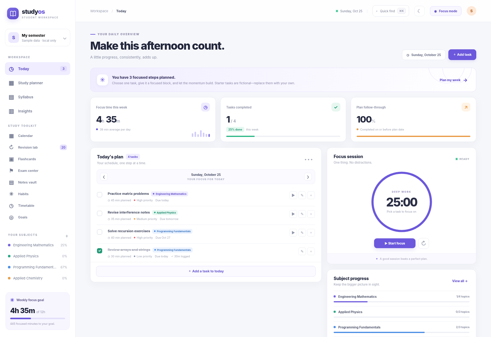
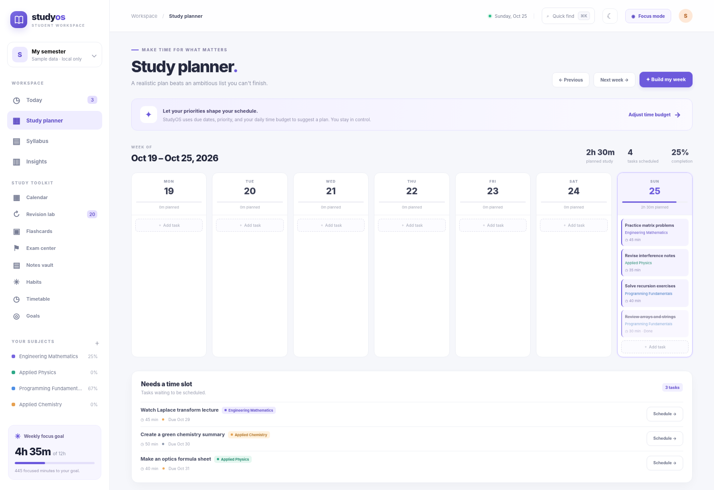
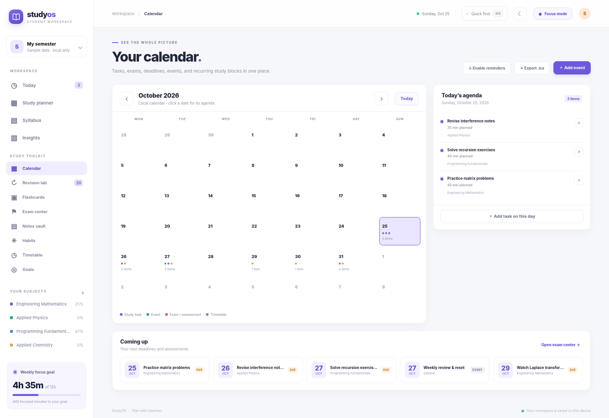
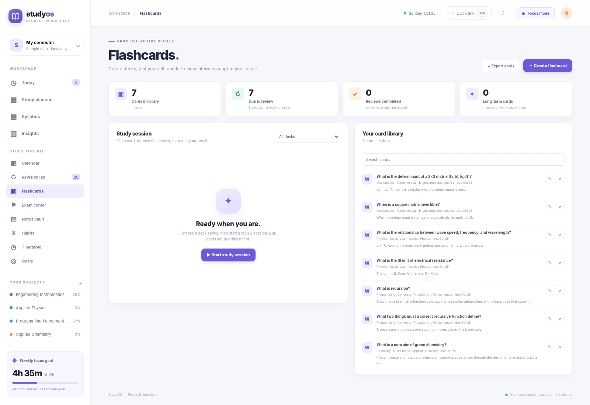
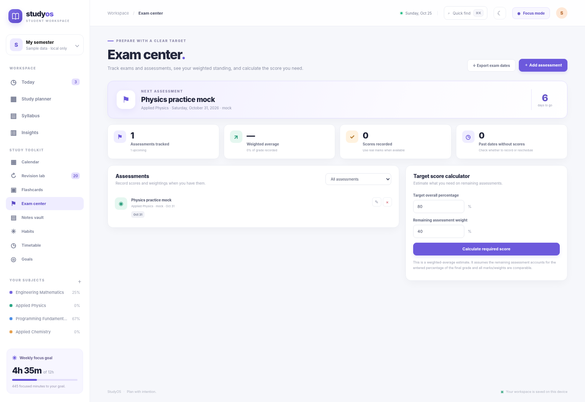

<div align="center">
  
  <h1>StudyOS</h1>
  <p><strong>Your all-in-one study workspace.</strong></p>
  <p>Plan the work. Protect your focus. Remember what you learn.</p>
  <p>
    
    
    
    <a href="https://github.com/voyager67/studyos/actions/workflows/quality.yml"></a>
  </p>
</div>

<p align="center">
  
</p>

### A quick look inside

<p align="center"><em>One workspace, connected study tools—not separate disconnected mini-apps.</em></p>

<table>
  <tr>
    <td width="50%"><br /><strong>Plan the week</strong></td>
    <td width="50%"><br /><strong>See deadlines and commitments</strong></td>
  </tr>
  <tr>
    <td width="50%"><br /><strong>Practise active recall</strong></td>
    <td width="50%"><br /><strong>Understand exam targets</strong></td>
  </tr>
</table>

These screenshots show the fictional starter workspace. All records are editable, and the app runs locally in your browser.

StudyOS is a complete, local-first workspace with **13 connected screens and 19 feature areas** for managing the whole study loop: plan a realistic week, track a syllabus, focus on tasks, practise active recall, schedule revisions, record assessments, organise notes, build habits, and measure progress. It is designed as a useful personal tool and a substantial portfolio project—not a landing page full of non-functional buttons.

> **Privacy and scope:** StudyOS runs in your browser. It has no account system, backend, analytics service, remote AI calls, third-party fonts, or cloud sync. The planner uses transparent scheduling rules; it is **not an AI model**. Your workspace stays in this browser unless you export it.

## The whole toolkit, in one place

| Workspace | What you can do |
|---|---|
| **Today dashboard** | See today's tasks, deadlines, completion state, subject progress, and quick actions. |
| **Task manager** | Create, edit, complete, delete, and prioritise tasks; set estimates, due dates, planned dates, subject links, and notes. |
| **Weekly planner** | Review a Monday–Sunday plan, move across weeks, and create a rule-based plan from outstanding tasks. |
| **Syllabus tracker** | Create subjects, add chapters in bulk, set exam dates, colour-code subjects, and cycle topics through To do, In progress, and Done. |
| **Smart scheduler** | Split large tasks into manageable focus blocks and distribute the pieces across a 21-day horizon using available study windows and deadlines. It reports any sessions that could not fit. |
| **Focus mode** | Use the built-in focus timer, pause or reset a session, link focus to a task, and log time for progress reports. |
| **Insights** | Review focus minutes, task completions, study streaks, recent focus history, and time recorded by subject. |
| **Calendar** | Combine task dates, deadlines, subject exam dates, assessments, events, and recurring timetable blocks in a month view. Export an `.ics` calendar file. |
| **Revision lab** | Turn syllabus topics into an active-recall queue. Rate recall as Again, Hard, Good, or Easy and receive an adjustable spaced-review interval. |
| **Flashcards** | Create decks, search cards, flip prompts, rate recall, track review history, and export your card library to CSV. |
| **Exam center** | Track exams, quizzes, assignments, mock tests, marks, maximum scores, and weights. Calculate an estimated score needed to reach a target percentage. |
| **Notes vault** | Create subject-linked notes, add comma-separated tags and safe resource links, pin notes, search content, and export notes as Markdown. |
| **Habits and routines** | Define repeatable habits, set weekly targets, log daily check-ins, view recent consistency, and export habit history. |
| **Timetable and availability** | Create recurring study windows, classes, and personal blocks. Receive overlap warnings and use study windows as planner capacity. Export the timetable. |
| **Goals and milestones** | Set targets for focus minutes, completed tasks, finished syllabus topics, or flashcard reviews. Progress is calculated from local records. |
| **Quick Find** | Search tasks, subjects, notes, flashcards, and assessments from a keyboard-driven command palette. |
| **Personalisation** | Switch light/dark themes, customise planning preferences, and request in-browser deadline reminders. |
| **Backup and portability** | Export the complete workspace as JSON, restore a JSON backup, or export task and feature-specific CSV/Markdown/ICS files. |
| **Installable/offline shell** | On a supported secure origin, install StudyOS as a progressive web app. The application shell is cached for offline reopening; data remains local to the browser. |

For the detailed capability inventory, see [FEATURES.md](FEATURES.md) and [COMPLETE_EDITION.md](COMPLETE_EDITION.md). Start with [GETTING_STARTED.md](GETTING_STARTED.md), check [KEYBOARD_SHORTCUTS.md](KEYBOARD_SHORTCUTS.md), and use [MANUAL_GITHUB_UPLOAD.md](MANUAL_GITHUB_UPLOAD.md) if you publish through GitHub’s website.

## Start using StudyOS

### Option A — Run locally on Windows

1. Download or clone the repository and extract it.
2. Ensure Python 3 is installed. No Python packages need to be installed.
3. Double-click `run_windows.bat`.
4. Your browser opens `http://127.0.0.1:8080`.
5. Keep the console window open while using StudyOS. Close it to stop the local server.

### Option B — Run locally on macOS or Linux

From the project directory:

```bash
./run_mac_linux.sh
```

The launcher starts Python's built-in static file server and opens `http://127.0.0.1:8080`. You may instead run `python3 -m http.server 8080` and open that address yourself.

### Option C — Open the page directly

You can open `index.html` directly for a quick look, but a local server is recommended. Service-worker/offline features require a secure context such as `localhost` or an HTTPS deployment.

## Make it your own

StudyOS starts with clearly fictional sample subjects, tasks, revision prompts, notes, cards, habits, goals, and an example assessment so the screens are populated on first launch. Review the data before using it as your own. To clear the example workspace, open **Preferences → Data & privacy → Reset data**. Resetting is destructive; export a JSON backup first if you need anything in the current workspace.

Your data is stored in the browser's local storage for the site origin. It does **not** automatically synchronise between browsers, devices, or separate hosting URLs. Use **Preferences → Data & privacy → Export JSON** to make a complete backup, and **Import JSON** to restore it. Treat backups as private because they can contain your personal plans, notes, and grades.

## Host it on GitHub Pages

StudyOS is a static web application and does not need a backend service. After uploading the repository:

1. Open the repository on GitHub and go to **Settings → Pages**.
2. Under **Build and deployment**, choose **Deploy from a branch**.
3. Choose branch `main` and folder `/(root)`, then save.
4. Wait for GitHub Pages to finish publishing and open the URL shown in the Pages panel.

The site is public if the repository and Pages site are public, but each visitor's StudyOS records remain in that visitor's own browser storage. Publishing the app does not give you access to visitors' private data. A GitHub Pages deployment should be served over HTTPS for service-worker/PWA support.

## Tests and quality checks

The scheduling and feature calculations are covered by dependency-free Node.js tests. With Node.js 18 or newer installed, run:

```bash
node --check app.js
node --check features.js
node --test tests/*.test.js
```

GitHub Actions runs the syntax checks and test suite on pushes and pull requests. The preparation checks also include Chromium UI smoke tests and responsive-width checks; their scope and limits are documented in [QUALITY_CHECKS.md](QUALITY_CHECKS.md). A successful test run is not a formal accessibility or security certification. Review [TROUBLESHOOTING.md](TROUBLESHOOTING.md) if something looks wrong.

## Project structure

```text
studyos/
├── .github/workflows/quality.yml   # CI checks
├── assets/                         # App mark and dashboard preview
├── tests/                          # Scheduler and feature-logic tests
├── index.html                      # Application layout
├── styles.css                      # Responsive UI and themes
├── app.js                          # Core task, syllabus, timer, and insights logic
├── features.js                     # Calendar, revisions, cards, exams, notes, habits, etc.
├── manifest.webmanifest            # Installable app metadata
├── service-worker.js               # Offline app-shell cache
├── run_windows.bat                 # Windows launcher
├── run_mac_linux.sh                # macOS/Linux launcher
├── FEATURES.md                     # Complete feature inventory
├── COMPLETE_EDITION.md             # One integrated edition and capabilities
├── COMPLETE_EDITION.md             # Included capabilities, one integrated edition
├── GETTING_STARTED.md              # User guide
├── PRIVACY.md                      # Storage and privacy model
├── SECURITY.md                     # Security boundaries and reporting
├── QUALITY_CHECKS.md               # Checks performed and limitations
├── MANUAL_GITHUB_UPLOAD.md         # Website-only upload steps
├── KEYBOARD_SHORTCUTS.md           # Keyboard help
├── ARCHITECTURE.md                 # Design and data flow
└── TROUBLESHOOTING.md              # Common issues
```

## Important limitations

- There is no account, cross-device sync, multi-user collaboration, backend, or hosted database.
- Data saved in local storage may be lost if the browser/site storage is cleared. Keep backups.
- Notifications are best-effort browser notifications while StudyOS is open; they are not a reliable alarm service.
- The smart planner is a deterministic heuristic. It cannot know your real energy, understanding, or unexpected commitments unless you record them.
- Grade calculations are estimates based on the weights and marks you enter; verify them against your institution's official grading rules.
- Spaced repetition provides suggested review intervals; it is not a guarantee of retention or exam readiness.

See [PRIVACY.md](PRIVACY.md) before using sensitive notes and [CONTRIBUTING.md](CONTRIBUTING.md) before proposing changes.

## License

StudyOS is available under the MIT License. See [LICENSE](LICENSE).

---

<div align="center">
  <strong>StudyOS — Make learning intentional.</strong><br />
  Built as a student project. Designed to be useful every day.
</div>
